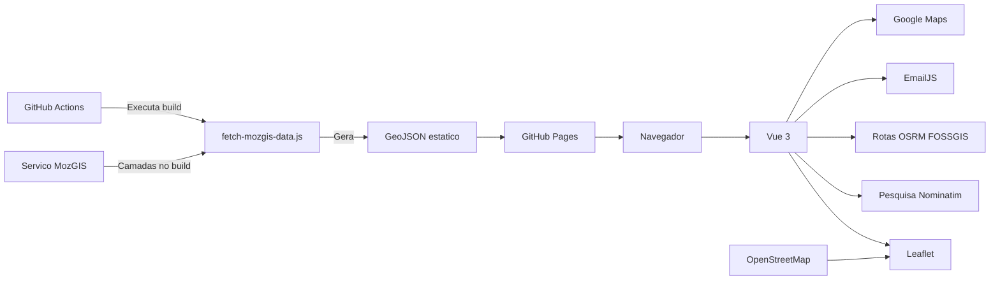

# Saúde Perto

Aplicação web para localizar hospitais, centros de saúde e postos de saúde em Moçambique. Reunimos dados geográficos do MozGIS num mapa interactivo e disponibilizamos pesquisa, informação de proximidade e cálculo de rotas.

**Código-fonte:** [github.com/jrdimande/hospital-finder](https://github.com/jrdimande/hospital-finder)<br>
**Aplicação:** [jrdimande.github.io/hospital-finder](https://jrdimande.github.io/hospital-finder/)

## Objectivo

Encontrar uma unidade sanitária, perceber onde fica e obter indicações para chegar até ela pode ser difícil quando não se conhece a localidade ou as opções disponíveis nas proximidades. O Saúde Perto reúne informação geográfica para facilitar essa pesquisa.

O utilizador pode procurar unidades por nome ou localização, consultar os resultados no mapa e, se autorizar o acesso à localização, ordenar as unidades por distância e pedir uma rota. Quando existe um contacto nos dados, a aplicação disponibiliza uma ligação para chamada.

> **Nota:** O Saúde Perto é uma ferramenta informativa. Não substitui os serviços de emergência e não confirma horários, disponibilidade ou serviços clínicos.

## Funcionalidades

| Área | Funcionalidade |
|:--|:--|
| Pesquisa | Pesquisa de unidades por nome, tipo, província, distrito e posto administrativo, com sugestões enquanto se escreve. |
| Pesquisa geográfica | Pesquisa de localidades no OpenStreetMap/Nominatim quando não há correspondências nos dados MozGIS. |
| Mapa | Mapa interactivo com marcadores diferenciados para hospitais, centros de saúde, postos de saúde e locais externos encontrados. |
| Informação | Consulta dos dados disponíveis da unidade, incluindo localização e contacto, quando fornecidos pela fonte. |
| Localização | Pedido de localização ao navegador mediante acção do utilizador e acompanhamento opcional da posição. |
| Proximidade | Ordenação de unidades por distância quando a posição está disponível. |
| Rotas | Trajectos a pé, de carro ou de mota, com distância e duração estimadas. |
| Navegação e contacto | Ligações para abrir o destino no Google Maps e para iniciar uma chamada quando o contacto pode ser convertido em ligação telefónica. |
| Reclamações | Formulário para comunicar dados incorrectos, problemas de mapa ou rota, problemas técnicos ou outros assuntos. |
| Estados da interface | Indicadores de carregamento, localização e cálculo de rota, mensagens de erro, tentativa de novo carregamento e estados sem resultados. |

## Utilização

1. Pesquise pelo nome de uma unidade, tipo ou localidade.
2. Consulte os resultados na lista ou seleccione um marcador no mapa para abrir os detalhes disponíveis.
3. Para encontrar unidades próximas ou calcular uma rota, autorize a localização quando o navegador a solicitar.
4. Escolha o modo de deslocação. A aplicação apresenta a rota, distância e duração estimada; também pode abrir o destino no Google Maps.
5. Se encontrar um problema, pode comunicá-lo através do formulário de reclamações.

O mapa permite seleccionar uma unidade e consultar um popup com os dados disponíveis. A pesquisa por texto consulta primeiro as unidades MozGIS; quando não encontra correspondências, procura locais adicionais no OpenStreetMap.

## Ecrãs e navegação

O projecto não utiliza Vue Router. `src/App.vue` selecciona a página através do fragmento (`hash`) da URL e do evento `hashchange`. Não há rotas com parâmetros nem uma página 404 dedicada.

| URL ou fragmento | Conteúdo |
|:--|:--|
| `/` | Página principal, com apresentação, pesquisa, mapa, resultados e reclamações. |
| `#inicio` | Apresentação e opção para procurar unidades próximas. |
| `#encontrar` | Área de pesquisa, mapa e lista de unidades. |
| `#mapa` | Painel do mapa interactivo. |
| `#reclamar` | Formulário de reclamações na página principal. |
| `#contacto` | Rodapé com fontes e ligações informativas. |
| `#/info` | Página Sobre, com informação sobre o projecto, as fontes e a geração dos dados. |

Os fragmentos de secção são âncoras da página principal. Um fragmento no formato `#/...` que não seja `#/info` apresenta a página principal.

## Dados e serviços externos

### Unidades sanitárias

Obtemos os dados do serviço geográfico público do MozGIS:

```text
https://www.mozgis.gov.mz/server/rest/services/MEF/MEFAAPUnidadesSanitarias/MapServer
```

O script `scripts/fetch-mozgis-data.js` descarrega as seguintes camadas durante o build:

| Camada | Categoria |
|:--|:--|
| 5 | Hospital |
| 6 | Centro de Saúde |
| 7 | Posto de Saúde |

O build valida as geometrias e coordenadas, selecciona propriedades usadas pela aplicação e gera `public/data/unidades.geojson`. Esse ficheiro é ignorado pelo Git e criado novamente em cada publicação. Em produção, `src/services/hospitalService.js` lê o GeoJSON estático do próprio site. A data de geração incluída no ficheiro é apresentada na página Sobre e corresponde à da última publicação, não à data de verificação no terreno.

O navegador não consulta directamente o serviço MozGIS em produção, evitando depender do acesso CORS do serviço no dispositivo de cada utilizador. Em desenvolvimento, o proxy do Vite encaminha pedidos a `/api/mozgis` para o serviço MozGIS. Durante o build, o script executado em Node descarrega os dados e prepara o ficheiro estático que será publicado.

### Mapa, pesquisa e rotas

| Serviço | Utilização |
|:--|:--|
| OpenStreetMap | Mosaicos do mapa e dados geográficos. A base de dados é disponibilizada sob a Open Database Licence (ODbL); mantemos a atribuição aos contribuidores apresentada no mapa. |
| Nominatim | Pesquisa de localidades em Moçambique quando não há correspondências nos dados das unidades sanitárias. |
| OSRM/FOSSGIS | Cálculo de rotas. O modo a pé usa o perfil pedonal; carro e mota usam o perfil rodoviário de carro. |
| Google Maps | Navegação externa para o destino seleccionado. |

**Tratamento dos dados:** A aplicação apresenta estados de carregamento, erro e lista vazia. Em desenvolvimento, pode apresentar dados das camadas carregadas e indicar uma falha parcial de outra camada. Para o build de produção, o script tem de descarregar com sucesso as três camadas. Os registos podem estar incompletos ou desactualizados; horários e disponibilidade devem ser confirmados directamente junto da unidade.

## Arquitectura

O frontend é executado no navegador. No build, o GitHub Actions descarrega os dados MozGIS e prepara o GeoJSON, que é publicado junto da aplicação no GitHub Pages. O navegador usa serviços externos para pesquisa geográfica, rotas, envio de reclamações e navegação externa.



## Tecnologias

| Tecnologia | Utilização |
|:--|:--|
| Vue 3 | Componentes, estado reactivo e interface. |
| Vite | Servidor de desenvolvimento, proxy MozGIS e build. |
| `@vitejs/plugin-vue` | Integração dos componentes Vue com o Vite. |
| Leaflet | Mapa interactivo, camadas e marcadores. |
| `@emailjs/browser` | Envio de reclamações através do EmailJS. |
| GitHub Actions e GitHub Pages | Build e publicação do site. |

As versões npm estão declaradas em `package.json`. MozGIS, OpenStreetMap/Nominatim, OSRM/FOSSGIS e Google Maps são serviços externos, não dependências npm declaradas.

## Organização do código

```text
.
├── .github/workflows/deploy.yml    # Build e publicação no GitHub Pages
├── scripts/
│   └── fetch-mozgis-data.js        # Recolha e preparação dos dados MozGIS
├── src/
│   ├── components/                 # Pesquisa, mapa, lista, navegação e reclamações
│   ├── composables/
│   │   ├── useHospitals.js         # Carregamento e estado dos dados das unidades
│   │   └── useGeolocation.js       # Pedido e acompanhamento da localização
│   ├── services/
│   │   ├── hospitalService.js      # Leitura e normalização das unidades
│   │   ├── placeSearchService.js   # Pesquisa de locais via Nominatim
│   │   └── routingService.js       # Cálculo de rotas via OSRM/FOSSGIS
│   ├── utils/
│   │   ├── distance.js             # Cálculo e apresentação de distâncias
│   │   └── phone.js                # Conversão de contactos para ligações telefónicas
│   ├── views/
│   │   ├── HomeView.vue            # Página principal
│   │   └── InfoView.vue            # Página Sobre
│   ├── App.vue                     # Navegação por hash
│   ├── main.js                     # Inicialização da aplicação
│   └── style.css                   # Estilos
├── .env.example                    # Nomes das variáveis EmailJS
├── .gitignore
├── index.html
├── package-lock.json
├── package.json
└── vite.config.js                  # Base de publicação e proxy de desenvolvimento
```

`public/data/unidades.geojson` é gerado pelo build e não é versionado.

## Execução local

O workflow de publicação utiliza Node.js 22. O `package.json` não fixa uma versão de Node. Como o repositório inclui `package-lock.json`, instalamos as dependências com `npm ci`.

```sh
git clone https://github.com/jrdimande/hospital-finder.git
cd hospital-finder
npm ci
npm run dev
```

Para criar e pré-visualizar a versão de produção:

```sh
npm run build
npm run preview
```

Os comandos são iguais em Windows PowerShell, Linux e macOS. `npm run build` executa primeiro `npm run fetch:data` e depois `vite build`; por isso, o serviço MozGIS tem de estar acessível durante a recolha dos dados. Em desenvolvimento, o proxy do Vite encaminha `/api/mozgis` para `https://www.mozgis.gov.mz` e reescreve o caminho para `/server/rest/services`.

## Configuração do EmailJS

O formulário utiliza o SDK `@emailjs/browser` e requer estas variáveis:

| Variável | Finalidade |
|:--|:--|
| `VITE_EMAILJS_SERVICE_ID` | Identifica o serviço EmailJS. |
| `VITE_EMAILJS_TEMPLATE_ID` | Identifica o template de mensagem. |
| `VITE_EMAILJS_PUBLIC_KEY` | Chave pública utilizada no navegador. |

O ficheiro `.env.example` contém os nomes sem valores. Para desenvolvimento, copiamos esse ficheiro para `.env.local` e preenchemos os valores obtidos no painel EmailJS:

```sh
cp .env.example .env.local
```

Os templates de mensagem são configurados no painel EmailJS. Recomendamos limitar os domínios autorizados ao GitHub Pages e aos domínios locais necessários. O formulário valida campos obrigatórios, formato de e-mail, tipo de problema e limites de 120 caracteres para o nome, 254 para o e-mail e 3000 para a descrição. Depois do envio, apresenta confirmação ou erro; sem as três variáveis, fica desactivado.

> **Importante:** O formulário pede que não sejam incluídos dados clínicos na descrição da reclamação.

O `.gitignore` ignora `.env.local`, mas não ignora um ficheiro chamado `.env`. Não guardamos valores de configuração num ficheiro `.env` que possa ser versionado. O workflow actual não mapeia secrets EmailJS para o passo de build. Para configurar o formulário no site publicado, seria necessário adicionar esse mapeamento ao workflow; guardar secrets nas definições do GitHub, por si só, não os disponibiliza ao build.

## Publicação

O workflow `.github/workflows/deploy.yml` executa em pushes para `master` ou por início manual. Instala as dependências, executa `npm run build`, carrega a pasta `dist` e publica-a no GitHub Pages.

Em `vite.config.js`, o `base` é definido como `/<nome-do-repositório>/` quando o build é executado pelo GitHub Actions com `GITHUB_REPOSITORY` disponível. Nos outros casos, o `base` é `/`. A navegação da aplicação usa hashes tratados manualmente; não há Vue Router nem modo de histórico HTML5.

Para activar a publicação, seleccionamos **Settings → Pages → Build and deployment → Source → GitHub Actions**. O workflow também pode ser iniciado na página **Actions**.

O workflow está configurado para `master`, enquanto o remoto aponta `origin/HEAD` para `main`. Um push apenas para `main` não activa o workflow.

## Privacidade e limitações

Pedimos a localização apenas após uma acção do utilizador e mantemo-la em memória no navegador; o código não a grava numa base de dados própria. Ao pedir uma rota, enviamos as coordenadas de origem e destino ao serviço externo OSRM/FOSSGIS. O link externo do Google Maps também pode incluir as coordenadas de origem. Aplicam-se as políticas dos serviços externos.

Os valores com prefixo `VITE_` são incorporados no frontend e não são segredos. No EmailJS usamos a Public Key prevista para o cliente. O código escapa caracteres HTML dos dados apresentados nos popups do mapa.

| Limitação | Impacto |
|:--|:--|
| Dados MozGIS podem estar incompletos ou desactualizados. | A data de geração não confirma a actualidade no terreno. |
| Horários e disponibilidade não são fornecidos. | O utilizador deve confirmar directamente com a unidade. |
| O modo mota utiliza o perfil de carro. | O percurso pode não reflectir restrições específicas para motas. |
| Pesquisa Nominatim pode devolver outros locais. | Resultados externos não são necessariamente unidades sanitárias. |
| A aplicação depende de serviços externos. | Mapas, pesquisa, rotas e reclamações requerem Internet e disponibilidade dos respectivos serviços. |

Não implementamos triagem clínica, marcações, lotação em tempo real, contas de utilizador, histórico de utilização nem integração com sistemas de emergência.

## Testes

O `package.json` não define um script `test` e não encontrámos testes automatizados no projecto. O workflow verifica se existe um script de testes e, no estado actual, ignora essa etapa. Podemos validar a compilação com:

```sh
npm run build
```

Antes da entrega, recomendamos testar manualmente a pesquisa, a permissão de localização, as rotas nos três modos, a ligação telefónica quando existe contacto, o formulário EmailJS e os estados de erro e ausência de resultados. Estes são passos recomendados, não testes que afirmamos já ter executado.

## Equipa e contexto académico

Desenvolvemos o Saúde Perto no âmbito da unidade curricular Programação Web II, no Instituto Superior de Transportes e Comunicações (ISUTC), Turma LECC31, durante o 2.º semestre de 2026, sob orientação do docente Ivan Ruby.

| Membro | N.º de estudante | Utilizador GitHub |
|:--|:--:|:--|
| Timóteo Dimande Júnior | 7085 | [@jrdimande](https://github.com/jrdimande) |
| Rhiven Amade | 8557 | [@rhivss](https://github.com/rhivss) |
| Shelton Lewis Matiquite | 7988 | [@sheltonlewis0](https://github.com/sheltonlewis0) |
| Edwin Banda | 8029 | [@edwinbanda](https://github.com/edwinbanda) |

## Colaboração e ferramentas de IA

O histórico Git confirma os seguintes branches e pull requests integrados. A API consultada não apresentou reviews registadas para os pull requests.

| Branch | Pull request e alteração |
|:--|:--|
| `rhiven/reclamacoes-email` | [PR #1](https://github.com/jrdimande/hospital-finder/pull/1), formulário de reclamações com EmailJS. |
| `rhiven/reclamacoes-email-v3` | [PR #2](https://github.com/jrdimande/hospital-finder/pull/2), integração das reclamações na versão actualizada. |
| `Chamadas-telefónicas` | Branch remoto encontrado; o histórico inclui uma alteração de ligações telefónicas. |

O grupo descreve o seu processo de trabalho como desenvolvimento em branches próprios, revisão por outro membro e integração através de **Create a merge commit**. `main` e `master` têm referências diferentes no remoto. O `.env.example` contém apenas nomes de variáveis e não há um ficheiro `.env` versionado.

| Ferramenta de IA | Utilização | Partes do projecto |
|:--|:--|:--|
| GitHub Copilot | Utilizámos o Copilot para ajudar a identificar e resolver bugs e apoiar algumas tarefas de programação. | Apoio geral à depuração e ao desenvolvimento; não discriminamos ficheiros ou secções específicas do código. |

Compreendemos e assumimos responsabilidade por todo o código e texto entregues. As bibliotecas e os serviços externos utilizados estão identificados neste documento.

## Créditos e licenças

- **MozGIS:** fonte dos dados geográficos das unidades sanitárias. Consultar o geoportal para os termos de utilização aplicáveis.
- **OpenStreetMap contributors:** dados cartográficos sob a Open Database Licence (ODbL); mantemos a atribuição apresentada no mapa.
- **Nominatim:** serviço de pesquisa geográfica do OpenStreetMap.
- **OSRM/FOSSGIS:** serviço externo de cálculo de rotas.
- **Leaflet:** biblioteca de mapas, licença BSD-2-Clause.
- **EmailJS Browser SDK:** SDK de e-mail, licença BSD-3-Clause.
- **Vue, Vite e `@vitejs/plugin-vue`:** dependências licenciadas sob MIT.

O repositório não contém um ficheiro `LICENSE` na raiz e não declara uma licença própria para o código do projecto.
