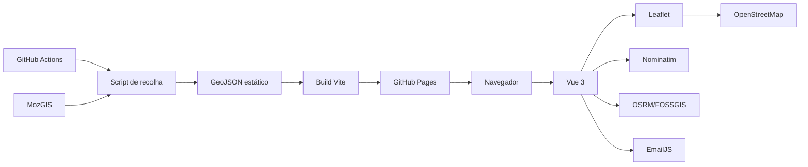

# Saúde Perto

**Saúde Perto** é uma aplicação web para localizar hospitais, centros de saúde e postos de saúde em Moçambique. A plataforma combina dados geográficos, pesquisa interactiva e mapas para ajudar utilizadores a encontrar unidades sanitárias próximas e consultar a melhor forma de chegar até elas.

[Aplicação publicada](https://jrdimande.github.io/hospital-finder/) · [Código-fonte](https://github.com/jrdimande/hospital-finder)

> [!IMPORTANT]
> Esta aplicação é uma ferramenta informativa. Não substitui os serviços de emergência e não confirma horários, disponibilidade de vagas ou serviços clínicos.

## Índice

- [Funcionalidades](#funcionalidades)
- [Tecnologias](#tecnologias)
- [Arquitectura](#arquitectura)
- [Fontes de dados](#fontes-de-dados)
- [Instalação e execução](#instalação-e-execução)
- [Configuração do EmailJS](#configuração-do-emailjs)
- [Publicação](#publicação)
- [Privacidade e limitações](#privacidade-e-limitações)
- [Testes](#testes)
- [Estrutura do projecto](#estrutura-do-projecto)
- [Equipa](#equipa)
- [Licenças e créditos](#licenças-e-créditos)

## Funcionalidades

- Pesquisa de unidades por nome, tipo, província, distrito ou posto administrativo.
- Sugestões de pesquisa durante a escrita.
- Pesquisa de localidades no OpenStreetMap/Nominatim.
- Mapa interactivo com marcadores para hospitais, centros de saúde, postos de saúde e locais externos.
- Cálculo de distância em linha recta a partir da localização do utilizador.
- Ordenação dos resultados por proximidade.
- Cálculo de rotas a pé, de carro ou de mota através do OSRM/FOSSGIS.
- Navegação externa para o destino no Google Maps.
- Ligações telefónicas quando existe um contacto válido.
- Envio de reclamações sobre dados, mapa, rotas e problemas técnicos.
- Estados visuais para carregamento, erro, pesquisa em curso e ausência de resultados.

Os locais encontrados no Nominatim podem não corresponder a unidades sanitárias oficiais. Estes resultados são apresentados separadamente dos registos MozGIS.

## Tecnologias

| Categoria | Tecnologia |
|:--|:--|
| Interface | Vue 3 |
| Build e desenvolvimento | Vite 6 |
| Mapa interactivo | Leaflet 1.9 |
| Formulário de contacto | EmailJS Browser SDK |
| Hospedagem | GitHub Pages |
| Integração e entrega | GitHub Actions |

### Dependências principais

```text
Vue 3
Vite
@vitejs/plugin-vue
Leaflet
@emailjs/browser
```

As versões exactas das dependências estão definidas em `package.json` e `package-lock.json`.

## Arquitetura

O frontend Vue é executado no navegador. Durante o build de produção, o GitHub Actions executa um script que recolhe as unidades sanitárias do MozGIS e gera um ficheiro GeoJSON estático.



O ficheiro `public/data/unidades.geojson` é gerado durante o build e não é mantido no repositório.

## Fontes de dados

### Unidades sanitárias

Os dados geográficos das unidades sanitárias são obtidos do serviço público MozGIS:

```text
https://www.mozgis.gov.mz/server/rest/services/MEF/MEFAAPUnidadesSanitarias/MapServer
```

O script `scripts/fetch-mozgis-data.js` recolhe as seguintes camadas:

| ID | Categoria |
|:--:|:--|
| 5 | Hospital |
| 6 | Centro de Saúde |
| 7 | Posto de Saúde |

O script valida geometrias e coordenadas, selecciona os atributos relevantes e gera `public/data/unidades.geojson`.

Em produção, o navegador lê o GeoJSON publicado junto da aplicação. Em desenvolvimento, o proxy do Vite encaminha `/api/mozgis` para o serviço MozGIS.

### Serviços externos

| Serviço | Utilização |
|:--|:--|
| OpenStreetMap | Mosaicos cartográficos e dados geográficos |
| Nominatim | Pesquisa de localidades em Moçambique |
| OSRM/FOSSGIS | Cálculo de distância e percurso |
| Google Maps | Navegação até ao destino |
| EmailJS | Envio do formulário de reclamações |

A disponibilidade dos serviços externos depende dos respectivos fornecedores e pode estar sujeita a limites de utilização, indisponibilidade ou alterações nos termos de serviço.

## Instalação e execução

### Pré-requisitos

- Node.js 22 ou superior
- npm
- Conectividade à Internet para descarregar dependências e dados MozGIS

### Execução local

```sh
git clone https://github.com/jrdimande/hospital-finder.git
cd hospital-finder
npm ci
npm run dev
```

O servidor de desenvolvimento é iniciado pelo Vite, normalmente em `http://localhost:5173`.

### Build de produção

```sh
npm run build
npm run preview
```

O comando `npm run build` recolhe os dados MozGIS e gera a versão final em `dist/`. Para que o build seja concluído, o serviço MozGIS deve estar acessível.

## Configuração do EmailJS

O formulário de reclamações utiliza o SDK `@emailjs/browser`. Para activá-lo em ambiente local, crie o ficheiro `.env.local` a partir do exemplo existente:

```sh
cp .env.example .env.local
```

Preencha as seguintes variáveis com os dados do painel EmailJS:

```dotenv
VITE_EMAILJS_SERVICE_ID=
VITE_EMAILJS_TEMPLATE_ID=
VITE_EMAILJS_PUBLIC_KEY=
```

| Variável | Função |
|:--|:--|
| `VITE_EMAILJS_SERVICE_ID` | Identifica o serviço configurado no EmailJS |
| `VITE_EMAILJS_TEMPLATE_ID` | Identifica o modelo da mensagem |
| `VITE_EMAILJS_PUBLIC_KEY` | Chave pública utilizada pelo SDK no navegador |

Sem estas três variáveis, o formulário permanece indisponível.

> [!WARNING]
> Variáveis com o prefixo `VITE_` são incluídas no código publicado e não devem conter dados secretos.

Recomenda-se configurar os domínios autorizados no EmailJS para permitir apenas os endereços necessários, como o domínio local de desenvolvimento e o GitHub Pages.

## Publicação

A publicação é realizada pelo workflow `.github/workflows/deploy.yml`.

- O workflow é executado em pushes para o branch `master`.
- Também pode ser iniciado manualmente em **Actions → CI/CD — GitHub Pages → Run workflow**.
- As dependências são instaladas com `npm ci`.
- Os dados são recolhidos e o projecto é compilado com `npm run build`.
- O conteúdo de `dist/` é publicado no GitHub Pages.

Para activar o GitHub Pages:

1. Aceda a **Settings → Pages**.
2. Em **Build and deployment**, seleccione **GitHub Actions** como origem.

### Navegação e URL base

A aplicação utiliza fragmentos da URL em vez do Vue Router. `vite.config.js` define o URL base como `/nome-do-repositório/` em builds executados pelo GitHub Actions e `/` nos restantes ambientes.

O branch padrão configurado no repositório remoto pode diferir do branch que activa a publicação. O workflow actual observa `master`.

## Privacidade e limitações

- A localização do utilizador só é solicitada após uma ação explícita.
- A localização é mantida em memória no navegador e não é armazenada pela aplicação.
- Ao calcular uma rota, as coordenadas de origem e destino são enviadas ao OSRM/FOSSGIS.
- As ligações para o Google Maps podem enviar dados de destino e localização.
- Os dados apresentados pela interface podem estar incompletos ou desactualizados.
- Horários de funcionamento, disponibilidade e serviços clínicos não são fornecidos.
- O perfil de mota utiliza o perfil rodoviário de carro e pode não reflectir todas as restrições aplicáveis.
- A aplicação não implementa triagem clínica, marcações, lotação em tempo real ou integração com sistemas de emergência.

Não devem ser incluídos dados clínicos ou pessoais sensíveis no formulário de reclamações.

## Testes

O projecto não possui actualmente um script `test` nem uma suite automatizada. O workflow verifica a sua existência e ignora esta etapa quando não está disponível.

Antes de uma entrega ou publicação, recomenda-se testar manualmente:

- Pesquisa por unidade e por localidade.
- Pedido e actualização da localização.
- Cálculo de rotas a pé, de carro e de mota.
- Ligações telefónicas.
- Envio de reclamações com e sem configuração do EmailJS.
- Estados de erro e ausência de resultados.
- Navegação no GitHub Pages.

## Estrutura do projecto

```text
.
├── .github/workflows/deploy.yml
├── scripts/
│   └── fetch-mozgis-data.js
├── src/
│   ├── components/
│   ├── composables/
│   │   ├── useHospitals.js
│   │   └── useGeolocation.js
│   ├── services/
│   │   ├── hospitalService.js
│   │   ├── placeSearchService.js
│   │   └── routingService.js
│   ├── utils/
│   │   ├── distance.js
│   │   └── phone.js
│   ├── views/
│   │   ├── HomeView.vue
│   │   └── InfoView.vue
│   ├── App.vue
│   ├── main.js
│   └── style.css
├── .env.example
├── index.html
├── package.json
├── package-lock.json
└── vite.config.js
```

## Equipa

Projecto desenvolvido no âmbito da unidade curricular **Programação Web II**, no Instituto Superior de Transportes e Comunicações (ISUTC), Turma LECC31, durante o 2.º semestre de 2026.

**Docente:** Ivan Ruby

| Membro | Número | GitHub |
|:--|:--:|:--|
| Timóteo Dimande Júnior | 7085 | [@jrdimande](https://github.com/jrdimande) |
| Rhiven Amade | 8557 | [@rhivss](https://github.com/rhivss) |
| Shelton Lewis Matiquite | 7988 | [@sheltonlewis0](https://github.com/sheltonlewis0) |
| Edwin Banda | 8029 | [@edwinbanda](https://github.com/edwinbanda) |

O desenvolvimento foi organizado em branches e revisões por pull request. Foram utilizados GitHub Copilot e outras ferramentas de apoio à identificação de bugs e à implementação de funcionalidades.

Todo o código e toda a documentação entregues foram compreendidos e validados pelos membros da equipa.

## Licenças e créditos

- **MozGIS:** fonte dos dados geográficos das unidades sanitárias.
- **OpenStreetMap contributors:** dados cartográficos disponibilizados sob a Open Database Licence (ODbL).
- **Nominatim:** serviço de pesquisa geográfica do OpenStreetMap.
- **OSRM/FOSSGIS:** serviço de cálculo de rotas.
- **Leaflet:** biblioteca BSD-2-Clause.
- **EmailJS Browser SDK:** SDK licenciada sob BSD-3-Clause.
- **Vue, Vite e @vitejs/plugin-vue:** licenças MIT.

O repositório não contém actualmente um ficheiro `LICENSE` próprio. Antes de uma distribuição pública, a equipa deve definir explicitamente a licença do código e dos dados produzidos pelo projecto.
